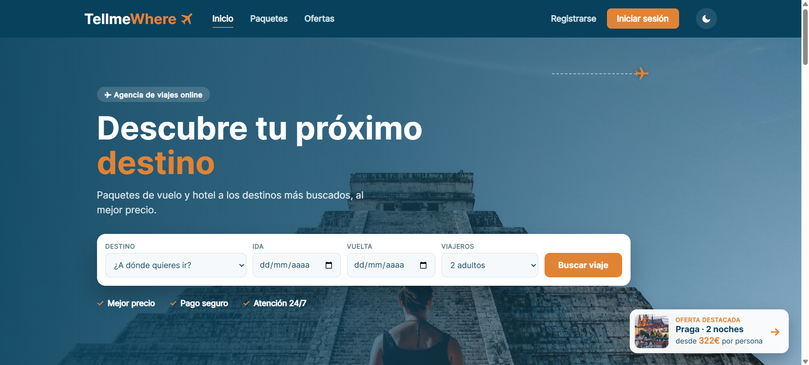
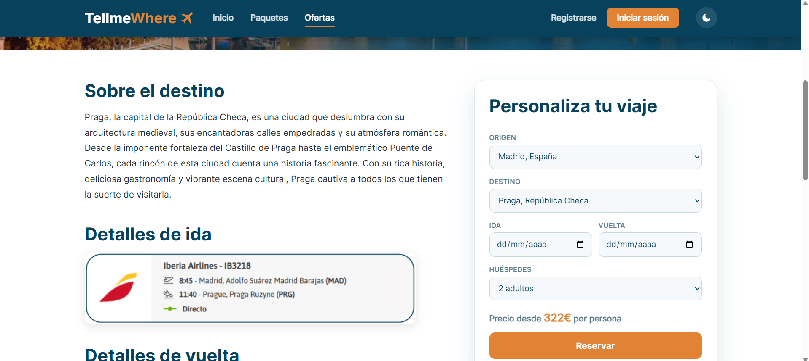
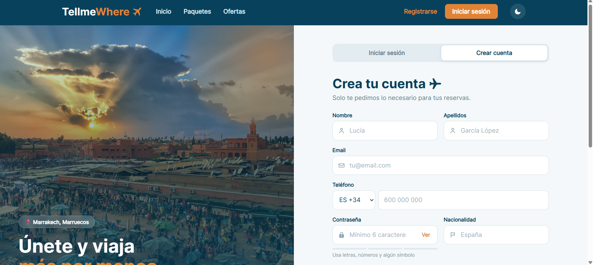
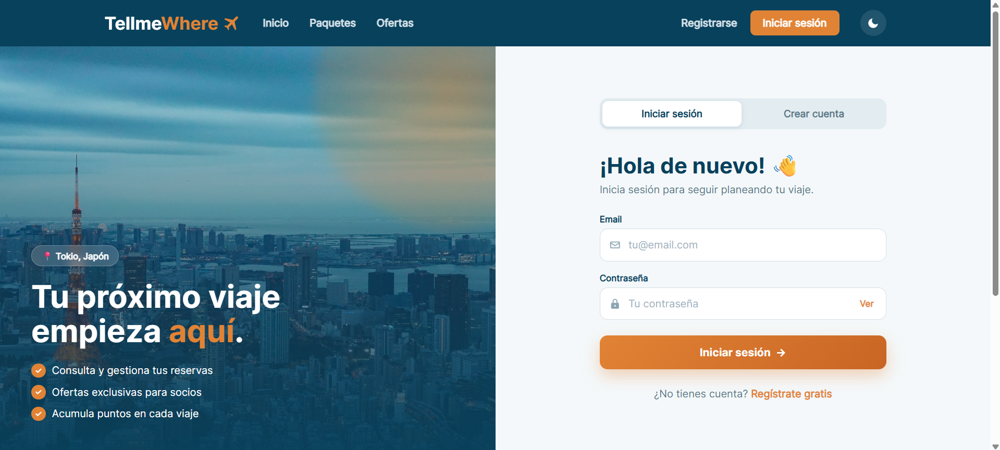
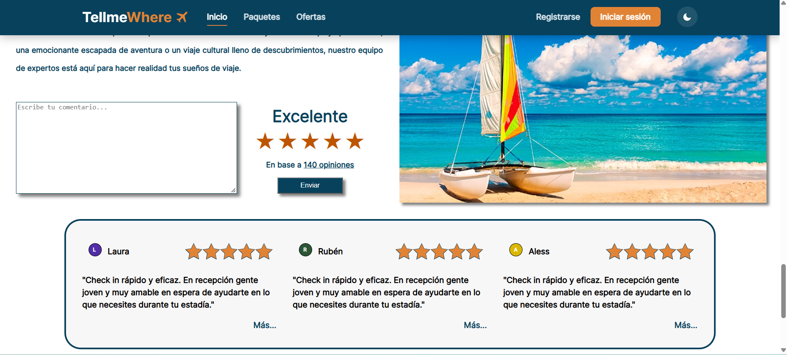
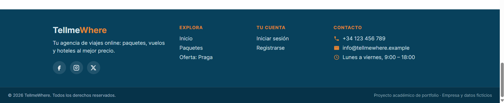

# TellmeWhere · Agencia de viajes online


Web de una agencia de viajes para explorar **paquetes turísticos, hoteles y vuelos** por destino, con registro e inicio de sesión de usuarios.

> 👥 **Proyecto en equipo** del 2.º curso del ciclo de **Desarrollo de Aplicaciones Web (DAW)**, hecho por tres compañeros: Antonio Cordero Caña, Marta Hinojosa y Carlos Díaz.



## ✨ Funcionalidades

- **Registro de usuarios** con validación en el servidor: campos obligatorios, formato del teléfono y email no repetido.
- **Inicio y cierre de sesión** con `express-session`. El nombre del usuario aparece en la cabecera mientras la sesión está activa.
- **Contraseñas cifradas con bcrypt**: en la base de datos nunca se guarda la contraseña real.
- **Consultas parametrizadas** (`?`) con `mysql2`, para evitar inyección SQL.
- **Buscador en la página de inicio** por destino, fechas y número de viajeros, que lleva al listado con el destino ya filtrado.
- **Listado de productos** con filtro por destino (Praga, Roma, Tokio, Marrakech, Budapest, Barcelona…).
- **Ficha de producto** con información del destino, vuelos de ida y vuelta, hotel y opciones para personalizar el viaje.
- **Carrusel de destinos** y sección de **opiniones de clientes** en la página de inicio.
- **Modo oscuro** con un botón en la cabecera.
- **Base de datos relacional** con usuarios, vuelos, hoteles, paquetes, compras y comentarios.

## 📸 Capturas

**Paquetes de vuelo + hotel**


**Ficha de producto**



| Crear cuenta | Iniciar sesión |
|---|---|
|  |  |

**Opiniones de clientes**



**Footer**



## 🛠️ Tecnologías

| Área | Herramientas |
|---|---|
| Backend | Node.js, Express |
| Vistas | EJS, HTML, CSS (sin frameworks), JavaScript |
| Base de datos | MariaDB / MySQL, `mysql2` |
| Seguridad | bcryptjs, express-session, dotenv |
| Equipo | Git y GitHub, Discord |

## 📁 Estructura del proyecto

```
tell-me-where-agencia-viajes/
├── scripts/
│   ├── crear-bd.js        # Crea la base de datos con los datos de ejemplo
│   └── dev.js             # Arranca en modo desarrollo y abre el navegador
├── src/
│   ├── controller/        # Lógica de cada ruta (registro, login, vistas…)
│   ├── routes/            # Definición de las rutas de Express
│   ├── views/             # Plantillas EJS y partials (cabecera y pie)
│   ├── css/  js/  img/  fonts/
│   ├── conexion.js        # Conexión a la base de datos (pool de mysql2)
│   └── server.js          # Punto de entrada del servidor
├── TellmeWhereDB.sql      # Script de la base de datos
└── .env.example           # Plantilla de configuración
```

El proyecto sigue una estructura **rutas → controlador → vistas**. Solo se publican las carpetas `css`, `js`, `img` y `fonts`, para que los archivos del servidor (como la conexión a la base de datos) no sean accesibles desde el navegador.

## 🚀 Cómo ejecutarlo en local

Necesitas [Node.js](https://nodejs.org/) 20 o superior y **MariaDB** o **MySQL** en marcha.

```bash
git clone https://github.com/corderocana-dev/tell-me-where-agencia-viajes.git
cd tell-me-where-agencia-viajes
npm install
```

1. Copia `.env.example` como `.env` y pon los datos de tu base de datos (usuario, contraseña, puerto…).
2. Crea la base de datos con los datos de ejemplo:
   ```bash
   npm run db:init
   ```
   ⚠️ Si ya existe una base de datos llamada `tellmewhere`, este comando la borra y la vuelve a crear.
3. Arranca la web:
   ```bash
   npm run dev
   ```
   Se abre sola en `http://localhost:3000`.

## 👥 Trabajo en equipo

| Integrante |
|---|
| **Antonio Cordero Caña** · [GitHub](https://github.com/corderocana) |
| **Marta Hinojosa** |
| **Carlos Díaz** |

Fue **nuestro primer proyecto en equipo** y lo planteamos como una oportunidad para aprender. En lugar de que cada uno se encargara siempre de lo mismo, **los tres tocamos un poco de todo**: maquetación y estilos, vistas EJS, rutas y lógica en Express, y base de datos.

**Cómo nos organizamos**
- **En clase, de forma presencial**, trabajando juntos durante el horario lectivo.
- **En remoto**, conectados por **Discord** para resolver dudas y avanzar a la vez.
- **Por separado**, repartiéndonos las tareas para que cada uno avanzara en la suya.
- Usábamos **Git y GitHub** para juntar el trabajo de los tres.

**Dificultades que nos encontramos**
- **Conectar la aplicación con la base de datos.** Fue lo que más nos costó al principio: configurar el usuario, la contraseña y el puerto, y entender por qué fallaba la conexión. Al final el proyecto lee estos datos de un archivo `.env` y avisa con un mensaje claro si no consigue conectar.
- **Organizar las ramas de GitHub.** Trabajar tres personas a la vez en el mismo repositorio nos obligó a aprender a usar ramas, juntar cambios y resolver conflictos.
- **Encajar la maquetación.** Con CSS, sin frameworks, nos costaba que cada pieza quedara en su sitio: que las secciones de cada uno encajaran entre sí y se vieran bien en distintos tamaños de pantalla.
- **Momentos de estrés** con las entregas. Aun así nos compenetramos muy bien: nunca hubo discusiones fuertes y **el buen ambiente estuvo por encima de todo**.

**Lo que aprendí**
- **Trabajo en equipo**: a comunicarme bien con mis compañeros, a confiar en ellos y a delegar y repartir tareas.
- **Mucha lógica de programación**, al tocar todas las partes del proyecto: base de datos, servidor, vistas y estilos.
- A montar una aplicación web completa, desde la base de datos hasta la interfaz.
- A trabajar con Git en equipo: ramas, *merges* y conflictos.
- Que un buen ambiente de trabajo ayuda a sacar el proyecto adelante en los momentos difíciles.

## 🔜 Próximos pasos

- Mostrar los paquetes, hoteles y vuelos **desde la base de datos**, en lugar de tenerlos escritos en las vistas.
- Completar el proceso de **compra** y hacer que los **comentarios y valoraciones** se guarden en la base de datos (ya tienen sus tablas creadas).
- Usar los **puntos de usuario** para aplicar descuentos.

---

Proyecto académico con fines formativos. Los datos de usuarios, vuelos y hoteles son de ejemplo.
